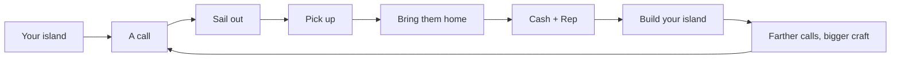

# 02 · Core loop and mechanics

Last rewrite: 2026-10-25. This file owns how the game plays: the loop, calls, pick-up, craft, building, quests,
the hub and the interface. `docs/00-design.md` is canon; if this file disagrees, 00 wins. Pay, rank and pacing
numbers are in `docs/03-progression.md`; Robux items in `docs/04-monetization.md`.

## 1. The loop

The loop is one sentence: **your island → a call → sail out → pick up → bring them home → build → farther calls.**
Every system either feeds a step or makes the island worth returning to.

- The island is the home base and the tycoon. It is where Cash becomes visible.
- The call is the action. It starts with a pager card, a flare, a pin and a beep, and ends with a survivor
  stepping off at a berth.
- The return trip is the quiet part: the sea, the bridges, the outer islands, the next call waiting.
- Progress is horizontal and vertical: farther calls and bigger craft (reach), plus a taller island (dock levels).

## 2. The first session

| Time | What happens | Why |
|---|---|---|
| 0:00 | Spawn at the hub visitor jetty. Bosun is beside you. The pager beeps within three seconds. | The game starts with a job, not a tutorial menu. |
| 0:00–1:30 | First call: one swimmer just off your cove. Drive the jet ski through the orange ring; the swimmer climbs aboard; "+1". | The core verb is taught by doing it once. |
| 1:30 | Drop off at your berth or the hub quay. Cash and Rep counters tick up. | The reward is immediate and visible. |
| 2:00–13:00 | Four more tutorial calls: a drifting dinghy, two survivors, a swimmer, a wildlife rescue. First rank at about 13 minutes. | A short, escalating chain; the second survivor shows that seats matter. |
| 5:00–15:00 | First dock level and the first quest pin. The island starts to change. | The tycoon hook lands before the first session ends. |
| 15:00 | The RIB is close. Calls move out of the cove; the map opens up. | A clear reason to come back tomorrow. |

There is no cold open, no cutscene and no dialogue box before the first call. The first call cannot be missed: it
is in the cove, the weather is calm, and the ring is visible from the jetty.

## 3. Calls

A call is one rescue job. The pager shows a card; a flare and a pin mark it in the world; the same card stays on
the HUD until the job ends. The card shows the kind, the distance, the survivors, and a Cash/Rep preview.

### 3.1 Kinds

| Call | What the player sees | Survivors | Timer | Spawns |
|---|---|---|---|---|
| **Swimmer in Trouble** | A person waving in open water | 1 | 2:30 | Your cove, open water, harbour mouth |
| **Drifting Craft** | A dinghy drifting with people aboard | 2 (tutorial: 1) | 3:00 | Your cove, open water, harbour mouth |
| **Rip Current** | A swimmer pulled out from the hub beach | 1 | 10:00 | Hub beach channel |
| **Sinking Vessel** | A boat low in the water; people in the sea | 3 | 8:00 | Offshore, far sea, deep sea |
| **Vessel Fire** | Smoke and orange light; the crew is already off | 2 | 8:00 | Offshore, far sea, deep sea |
| **Wildlife Rescue** | A seal pup or seabird tangled in line | 1 | 7:00 | Your cove, open water |
| **Diver at a Wreck** | A diver trapped beside a seabed wreck | 1 | 10:00 (13:00 at an island) | Dive sites, submarine only |
| **Capsized Ferry** (big call) | A ferry on its side, several people in the water | 4+, at least one per player | 7:00 | 300 studs off the hub harbour mouth |

- The timer starts when the call is offered, not when the player arrives. The card counts down; a late call can
  fail. A call with a survivor already aboard gets 90 seconds of grace to deliver.
- **No accept button.** Steer for the flare. The call is yours once it is offered; nobody else can take it.
- Calls 1–2 spawn in the player's own cove. From call 3 they use open-water distance tiers: 500–2,000,
  2,000–3,500 and 3,500–5,500 studs from the player's berth. The tier is capped by rank, not by a Robux craft.
- The first offer comes 3 seconds after the player is free; later offers about 9 seconds after the last one ends.
  A free-roam swimmer between calls keeps the sea alive.
- Big calls are public and server-wide. Every helper is credited at drop-off; the player who delivers a survivor
  gets the survivor share, and everyone aboard shares the completion bonus. The ferry timer is its own 7 minutes.

### 3.2 The call card

The card is a small bright panel, not a phone. It shows:

- a big kind icon (swimmer, boat, flame, paw, diver, ferry);
- the call name in one to three words;
- distance and a direction arrow;
- survivor pips (filled = aboard);
- a Cash/Rep preview at Silver, solo.

The card has no Accept or Decline. It fades to a compact strip once the player is moving, and returns when a
survivor is picked up.

### 3.3 Failure

When the timer runs out, the harbour patrol takes over. The player keeps 10% of the call's Cash, earns no Rep,
and the call clears. There is no lost survivor, no penalty pile and no retry button. The next call comes normally.
A late delivery is a Bronze at worst; a call only fails when the player never reaches it.

## 4. Pick-up and delivery

### 4.1 The ring

- An orange ring, 12 studs across, marks each survivor (12 studs from the hull centre).
- Inside the ring the craft eases its throttle to 7 studs/s and holds boarding speed. It never adds throttle.
- The survivor is taken when the craft is within 10 studs of the hull side, slower than 10 studs/s, and within
  22 degrees of level. This is deliberately forgiving on a phone.
- The survivor swims to the hull and climbs aboard in view. A "+1" and a chime confirm it. The seat pips fill.
- A full craft leaves the remaining survivors in the water with their rings. The player can come back or call a
  bigger craft.

### 4.2 Seats

| Craft | Seats | Survivors it can carry |
|---|---|---|
| Jet ski | 1 | 1 |
| RIB | 3 | 3 |
| Lifeboat | 4 | 8 |
| Rescue helicopter | 2 | 2 (winch) |
| Submarine | 2 | 2 |
| Storm Runner | 3 | 3 |
| Tidewalker | 6 | 6 |

The seat pips are the only capacity UI. No weight, no fuel, no damage. A survivor occupies one seat regardless of
kind.

### 4.3 Helicopter and submarine

- **Helicopter:** hover over the ring; the winch lowers and lifts each survivor in turn. Two seats, two winch
  slots. It cannot land on water, but it can drop off at a berth or the hub quay.
- **Submarine:** dive at a wreck, follow the ring on the seabed, and pick the diver up with the same ring rule.
  Two seats. It surfaces at a berth to drop off. It is the only craft that can take a diver call.

### 4.4 Drop-off

Drop off at **your own berth** or the **hub quay**; whichever is nearer counts. Hand-over is automatic inside the
drop zone. Cash and Rep are paid on the spot, with a short card: grade, base, distance, crew bonus, total. The
drop-off is also where the next call can be offered.

## 5. Craft

| Craft | How you get it | Top speed | Notes |
|---|---|---|---|
| **Jet ski** | Free, from the start | 69 studs/s | One seat; the tutorial craft. |
| **RIB** | 2,500 Cash at Lifeguard | 62 studs/s | Three seats; the first real rescue boat. |
| **Lifeboat** | 12,000 Cash at Coxswain | 46 studs/s | Four seats, eight survivors; long-range rescue boat. |
| **Rescue helicopter** | 75,000 Cash at Rescue Pilot + hangar | 90 studs/s | Two seats, winch; flies over everything. |
| **Submarine** | 40,000 Cash at Coxswain + sub pen | 40 surfaced / 22 dived | Two seats; the only diver rescue. |
| **Storm Runner** | Robux boat | Premium powerboat | Three seats. |
| **Tidewalker** | Robux boat | Luxury catamaran | Six seats. |
| **Riptide X** | Robux boat | Sport jet ski | One seat. |
| **Gilded Gull** | Robux boat | Gold luxe jet ski | One seat. |

- **Choose at the boat board** in the boathouse (or the jetty before it is built). The chosen craft is the one
  "Boat to me" brings.
- **Boat to me** brings the chosen craft to the player's position in 60 seconds. Quick Launch removes the wait.
  It is on the left column and on the boat board.
- **Handling is one model.** All boats use the same steering, throttle, brake and planing rules; the numbers above
  are top speed, not a handling tier. Paid craft do not get a better grade, a longer timer or a farther call.
- **No fuel, no repairs, no upgrades.** A craft is always ready. The only cooldown is "Boat to me".
- Craft are third-person only; the chase camera follows the hull, the winch or the dive. There is no cockpit view.

## 6. Your island

### 6.1 The plot

A flat Lego baseplate with a berth notch for the boat and the sub. The jetty is the first thing on it. The plot is
visible from the water and from the hub; everything the player builds stands on it.

### 6.2 Building

- The build station is a Lego builder's yard with a tablet on a stand. Using it moves the camera to a top-down
  view of the island. A bar of cards shows what can be built at each lot: Cash and rank, or Robux.
- Choosing a lot pulses a flat outline on the plate. There is no 3D ghost of the finished building.
- Buying plays the **Lego build**: bricks drop in from bottom to top with a bounce and a snap, builders standing
  by. The build is the reward animation.
- Tablet build mode is in progress (WP-14d). Until it ships, dock upgrades are bought at the dock lot and the lot
  builds in view.
- What can be built: dock levels 2–5, helipad + hangar, sub pen, quest-chain buildings (the lighthouse), and spare
  lots for later.

### 6.3 Dock levels

| Level | Adds | Unlocks |
|---|---|---|
| **1** | Jetty, berth notch | Jet ski, free. |
| **2** | Pontoon, lamp posts, flag, rescue board | Second berth. |
| **3** | Boathouse, boat board, paint booth | Choose a craft at the dock. |
| **4** | Lookout tower, slipway crane | No relaunch cooldown; lifeboat berth. |
| **5** | Station front, beacon, trophy hall | Harbourmaster; the gold beacon if top-ranked. |

Prices and rank requirements are in `docs/03-progression.md`; the Robux version is in `docs/04-monetization.md`.

### 6.4 Crew (in progress, WP-15)

Job seekers line up outside the station. A new group arrives every 20 minutes. Hire a mechanic, a lifeguard or a
dispatcher for a small boost and a daily wage. The crew lives on the island and is visible at the station. This is
the late-game Cash sink; it does not gate calls or ranks.

### 6.5 Flex

Everything is visible to the server: the dock, the hangar, the lighthouse, the trophy hall. The top-ranked Lv5
player's island carries a gold beacon seen across the harbour at night. The hub's rescuer monument names the
week's top rescuer. Flex is the point of building; it is never sold as a stat.

## 7. Quests and the Album

### 7.1 Quests

- Six givers at six hub camps. Each offers one quest a day.
- Kinds: **find** (pick an item up on an outer island), **deliver** (carry it from the camp to a drop spot),
  **salvage** (submarine, from a wreck), **rescue** (a call in a named zone, then bring the survivor home).
- A completed quest returns to the giver. The reward is Cash and Rep; the lamp chain also unlocks the lighthouse
  blueprint.
- Pins appear in the world and on the map. The Quests panel lists the pins, not a story.
- Talk zooms the camera and shows a short voiced line plus numbered replies. This is the only choice UI in
  gameplay.
- A quest never gates a rank, a call or a craft. The player can ignore all six givers and still reach Admiral.

### 7.2 Album and fog

- The Album has a page for the hub and one for each outer island: Skerry, Puffin Isle, Gannet Rock, Wreck Reef,
  the Arches, Mermaid Lagoon, Penwyn.
- Walking the hub lifts fog from the map. Finding a stamp, bottle, viewpoint or critter fills a page slot; a wreck
  and a page are rarer finds.
- Filling a page pays Cash. The Album is the exploration record, not a battle pass.
- Quest items, stickers and Album finds are all in the world. There is no gacha in exploration.

## 8. The hub and friends

- The hub is the social room: the call board, the shop counter, the harbourmaster's shack, the campfire stage,
  the rescuer monument, the visitor jetty and the six quest camps.
- Six players per server, one island each. Bridges connect the hub to every island, so a player can walk to a
  friend's dock and step aboard.
- Crew: up to four players ride together. Each extra crew member adds 10% Cash to a call, capped at 30%. The crew
  panel shows who is aboard. Crew hiring (NPC staff) is separate from a player crew.
- Friends on the same server earn +10% Cash each, capped at +30%. The bonus is shown on the payout card.
- There is no PvP, no ramming damage and no stealing a call. Soft collisions only push.

## 9. Interface and camera

- **Left column:** seven big square icon buttons: Shop, Quests, Album, Companion, Crew, Settings, Boat to me.
  Each opens a centred panel. The map is on M. The build tablet is its own top-down mode.
- **HUD:** Cash, Rep and rank at the top; the call card at the side; seat pips on the craft; a small quest pin
  compass. Icons and one to three words; no paragraphs.
- **No phone, no radio, no first-person cockpit.** The pager card and the flare are the call; the left column is
  the menu.
- **Camera:** third-person chase by default; a wider orbit on the helicopter; a top-down view for the tablet; a
  zoom-in for NPC talk. The camera never enters a cockpit.
- **Input:** every action on keyboard, touch and gamepad. Big touch targets; no hover-only actions. The build
  tablet supports tap and drag.
- **Choice UI:** none in gameplay, except NPC numbered replies, the build tablet and in-world counters/boards.

## 10. Map, scale and travel

- Hub about 800 studs across; six islands on a ring about 1,100 studs out; bridges between.
- Map radius about 7,000 studs. The playable call band is 500–5,500 studs from the player's berth.
- A jet-ski trip to a near call is about 45 seconds at cruise; a far call with a lifeboat or helicopter is a
  couple of minutes. Travel is the game, not a loading screen.
- No cars, roads, trains or teleport pads. The bridges are for walking and for the view; the boats are for work.
- The outer islands are landmarks, not shops: Skerry, Puffin Isle, Gannet Rock, Wreck Reef, the Arches, Mermaid
  Lagoon, Penwyn. Wrecks sit on the seabed below several of them.

## 11. Anti-grief

1. **No PvP.** No weapons, no ramming damage, no sinking another player's boat.
2. **Soft collisions.** Boats and players push apart; they never trap or launch.
3. **A call belongs to its player.** The flare and ring are theirs; another player cannot claim or steal it.
4. **Shared big calls.** The ferry is the exception: everyone can help, and every helper is credited by share.
5. **Dock and island are personal.** Visitors can walk and look; they cannot build, buy or move anything.
6. **One craft each.** "Boat to me" brings only the owner's craft; no towing or stealing.
7. **No downwash grief.** Helicopter rotor wash pushes water and props, not players over edges.
8. **Leave and return.** A disconnected player's call ends safely; the island and progress persist.
