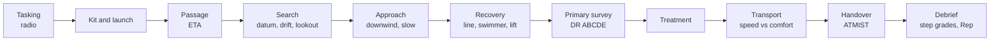

# 09 · Rescue operations

This is the heart of the game. A rescue in Mayday is an **operation**: a chain of real search-and-rescue procedure steps, and each step is a skill. Canon (names, tone, scope tags) comes from [`01-game-canon.md`](01-game-canon.md). The session loop, vehicles and map scale are in [`02-core-loop-and-mechanics.md`](02-core-loop-and-mechanics.md). Payouts, ranks and the certification thresholds are in [`03-progression.md`](03-progression.md). This file owns the operations, their steps, the radio, crew roles on scene, grading, certifications (their content; [document 03](03-progression.md) owns where they sit on the ladder) and the rescue kit.

Numbers marked **(tune)** are first guesses for playtests. Procedure details come from [`research/rescue-procedures.md`](research/rescue-procedures.md) plus general RNLI, HM Coastguard, USCG and IAMSAR practice. The primary sources were blocked during research, so anything marked **(verify: source)** must be checked against that source before it ships as "how the real crews do it" (in a loading tip, a badge text or the debrief). The game can keep a simplified mechanic; it must never teach a wrong procedure.

## 1. Design principles

1. **An operation is a chain of real steps.** Tasking, launch, passage, search, approach, recovery, assessment, treatment, transport, handover. The order is the real order, and the game names each step with a plain label and the real term underneath ("Check them over" / *Primary survey*).
2. **Every step is a skill, never a bare "hold E".** Each step tests one of five skills: **steering** (holding a line, a speed, a station), **timing** (a throw, a lift, a rhythm), **positioning** (where you are relative to wind, sea and casualty), **choosing gear** (the right kit for this casualty) and **reading the casualty** (looking at cues and choosing what they mean). A hold is allowed only when the player is doing something while holding (tracking a target, keeping a needle in a band).
3. **Real decisions with real consequences.** A wrong choice changes the operation, it does not just cost points:

   | Mistake | What happens in the game | Real reason |
   |---|---|---|
   | Approaching the swimmer fast or from upwind | Bow wave washes over them, they swallow water, condition drops; the boat may drift onto them and the crew calls "Abort, go round" | Wash and a boat drifting down onto a casualty are the main approach hazards (verify: COMDTINST M16114 PIW recovery) |
   | Lifting a very cold casualty upright | Condition drops sharply (*afterdrop*) | Hypothermic casualties are kept horizontal and handled gently ([research](research/rescue-procedures.md), 2e, 3c) |
   | Skipping the primary survey | The hidden problem (cold, a bump, water in the lungs) keeps getting worse; treatment does not stop the decline | Survey first, then treat |
   | Towing fast or snatching the line | Tension spikes, the line parts, everyone ducks, you re-pass the line | Snatch loads part lines ([research](research/rescue-procedures.md), section 4) |
   | Fouling your own propeller on the tow line | Engine stalls; the Crew must clear it while you drift | A loose line near the stern is a classic tow mistake (verify: COMDTINST M16114 towing) |
   | Wrong POB count to the Coastguard | The Coastguard keeps searching for a "missing" person; the debrief flags it | POB accounting closes a search |

4. **Graded per step.** Every step gets Gold, Silver or Bronze. The step grades make the operation grade (section 2.4), which feeds Reputation and a debrief screen with one tip per weak step.
5. **Failure is never grim.** All ages play this. No gore, no injury close-ups, no drowning, no death on screen or in text. The casualty's **condition meter** drops instead, and if it reaches Critical, the harbour patrol or the Coastguard helicopter takes over and the casualty is safe (section 2.5). The radio stays kind.
6. **Short and punchy.** No step runs longer than about 45 seconds of the same input, choices show 2 to 4 options with an icon and at most six words each, and the next step is cued by itself (section 10): in first person a sound and a glance cue turn the player's head toward it, never a camera cut; in chase-camera vehicles the camera eases to it.
7. **Simplify the physics, never the procedure.** Stud distances, meters and timings are game values. The sequence, the kit and the reasons are real.

## 2. Shared systems

### 2.1 Operation flow

Tow and fire operations swap the middle steps for their own (sections 6 and 8), but every operation starts with a tasking and ends with a handover and a debrief. Steps can overlap in a crew: the Medic treats during the passage home while the Helm drives. For beach and cliff operations the passage can be a drive: the lifeguard 4x4 or ATV to the tower, the coastguard response vehicle to a cliff-top rescue point, or a boat towed on its trailer to a public slipway ([document 10](10-world-and-map.md), section 3).

### 2.2 Casualty condition meter

Every casualty has a condition from 0 to 100 shown as a coloured bar with a plain word. It is the operation's clock: there is no countdown timer on standard operations.

| Band | Value (tune) | Label on screen | What the player sees |
|---|---|---|---|
| Stable | 70 to 100 | "OK" | Talking, waving, shivering if cold |
| Concern | 40 to 69 | "Struggling" | Low in the water, weak wave, slow answers |
| Serious | 20 to 39 | "Very cold" or "Not responding well" | Eyes closed, no shivering, slurred text |
| Critical | below 20 | "Needs help now" | Triggers the takeover (section 2.5) |

What moves it (all per casualty, tune):

| Driver | Effect |
|---|---|
| In the water, wearing a lifejacket | -1 every 5 s |
| In the water, no lifejacket | -1 every 3 s |
| Panicking | x1.5 decline until calmed |
| Storm sea state | x1.5 decline |
| Out of the water, wet, in the wind | -1 every 10 s |
| Hard slam in transport (hypothermic casualty) | -3 per slam |
| Wrong handling (upright lift when hypothermic, rubbing limbs) | -10 once |
| Correct treatment after a survey | Decline stops; +1 every 10 s while sheltered and wrapped |
| Treatment without a survey | Decline halves but never stops (the hidden problem) |

The rule of thumb behind the in-water rates is the cold-water "1-10-1" idea: about one minute of cold shock, about ten minutes of useful movement, about an hour before cold makes a person unconscious (verify: Giesbrecht, Cold Water Boot Camp; RNLI "Float to Live"). The game compresses it heavily. Survival-time-by-temperature figures are not shown anywhere ([research](research/rescue-procedures.md), 8c).

### 2.3 Reading the casualty

Casualties show their state through body language, a short speech line and sound, never through a text label alone. In Pro mode (section 9) the cues are all the player gets.

| State | What the player sees and hears | Real sign | Best recovery |
|---|---|---|---|
| Alert, tired | Waves both arms, calls out, swims weakly | Responsive, breathing normally | Throw bag or lifebuoy, then pull aboard |
| Panicking | Splashing, climbing at the water, head back, no answer to questions | Instinctive drowning response, cold shock (verify: RNLI; [research](research/rescue-procedures.md), 2f) | Swimmer with a rescue tube, kept at arm's length (section 5.4) |
| Exhausted | Low in the water, mouth near the surface, arms still | Exhaustion, early hypothermia | Swimmer, then a two-person lift |
| Very cold | Not shivering, slow speech ("m-m-my hands"), drowsy | Moderate hypothermia ([research](research/rescue-procedures.md), 3c) | Horizontal recovery: parbuckle net or two-person horizontal lift |
| Not responding | Face up in a lifejacket, eyes closed, no answer | Unresponsive (AVPU "U") | Swimmer, horizontal recovery, survey at once |

### 2.4 Grading and debrief

Each step has its own Gold, Silver and Bronze criteria (the step tables below). A step done by an NPC crewmate is graded Silver at most (section 4.2). A step skipped, or taken over by the fail-safe, scores zero.

- **Points.** Gold 3, Silver 2, Bronze 1, skipped 0. Every step has a weight (most are 1; the recovery step and the casualty's **condition at handover** are 2).
- **Operation grade.** Weighted average of 2.5 or more is Gold, 1.7 or more Silver, otherwise Bronze (tune). The payout multipliers are in [document 03](03-progression.md), section 2.
- **Care beats speed.** Speed is part of only a few steps (tasking acknowledgement, launch, passage). An operation done carefully and a little slowly still earns Gold.
- **Debrief screen.** A timeline of the steps with their grade icons, the condition graph over time, the Rep breakdown, and one short tip from Chief Aggie for the weakest step ("Come in from downwind next time, so your wash doesn't hit them"). One tap to close; it never blocks the next tasking for more than 10 seconds. Crew members each see their own steps highlighted.

### 2.5 Failure and takeover

If a casualty's condition reaches Critical, or a standard operation passes 12 minutes (tune), the Coastguard brings in the next asset: the harbour patrol boat inside Calm Bay, the Coastguard helicopter *Rescue Gale One* elsewhere. The radio is kind: "Haven Rescue, Gale Isles Coastguard. *Rescue Gale One* is two minutes out and will take the casualty. Good work holding on." The player is asked to **stand by and assist** (hold the boat steady for the winch, or shine a light), which is its own short step.

The casualty is always safe. The player keeps the step grades already earned: completed steps pay their share at half rate, with no completion share (tune, [document 03](03-progression.md), section 2). The player never loses Cash, Rep, kit or a certification.

The player can also fail personally: a capsized RIB or a swimmer swept away. Then the player floats in their lifejacket, the NPC crew (or Bosun) helps them right the boat or get back aboard, and the operation continues with a condition cost. Nobody on the crew is ever shown hurt.

### 2.6 Wind, sea and the storm

Wind direction matters in almost every step, so it is always readable: real cues first (spray streaks, flag on the boat, the angle of the waves, smoke), then in Assist mode a wind arrow on the HUD. Drift is wind (*leeway*) plus current, and a person in the water drifts mostly with the current, a boat mostly with the wind ([research](research/rescue-procedures.md), 8a).

An operation tasked during the Storm phase keeps storm sea state and the storm pay rate at its scene until the handover, the same rule as big calls ([document 02](02-core-loop-and-mechanics.md), section 8).

### 2.7 Controls convention

| Action | PC | Mobile | Gamepad |
|---|---|---|---|
| Throttle and steer | W/S, A/D | Left stick (auto-throttle at full push) or a throttle slider in Pro | RT/LT, left stick |
| Neutral (out of gear) | X | Neutral notch on the throttle slider | B |
| Aim | Mouse | Drag on the right half of the screen | Right stick |
| Action (throw, grab, lift) | Left click, hold to charge | Big Action button, hold to charge | A |
| Two-hand rhythm (hauling, CPR, pumping) | Left and right click alternately | Two pads, tap alternately | LB and RB alternately |
| Choice cards (kit, survey, triage, ATMIST) | Number keys 1 to 4 or click | Tap the card | D-pad or face buttons |
| Radio wheel | Hold R, point, release | Radio button, slide the thumb to an option | Hold D-pad up, right stick |
| Lookout (keep eyes on) | Hold right click with the reticle on the target | Keep a finger on the target | Hold RB with the reticle on |
| Swap crew station | Tab | Seat icon | Y |

Every rhythm and timing mechanic has a "wider window" accessibility option (it removes the Pro bonus, nothing else), and every sound cue has a visual ripple for players with sound off.

## 3. Radio

The radio is a real mechanic, not flavour. It carries the tasking, sets the datum on the chart, and grades the player's discipline: answer quickly, report accurately, say who you are.

### 3.1 Who is on the net

| Station | Callsign | Notes |
|---|---|---|
| Coordination centre | **Gale Isles Coastguard** | Invented coordination centre, the islands' version of an MRCC or JRCC. Tasks every unit, keeps the log, calls in the helicopter. Calm, precise voice. |
| Port Haven station | **Port Haven Lifeboat Station** (Chief Aggie on the base set) | Gives advice, never the tasking itself. |
| Player units | **Haven Rescue** plus a number: jet ski *Haven Rescue One-One*, RIB *Two-One*, lifeboat *Three-One*, helicopter crews ride *Rescue Gale One* or fly *Rescue Gale Two* | One callsign per vehicle, shown on the hull. |
| Others | Harbour patrol *Haven Patrol*, the ferry *Gale Queen*, *Northern Dawn*, Barnaby's *The Optimist*, the ambulance at the slipway | NPC voices. |

### 3.2 Message types

| Priority word | Meaning in the game | Real use |
|---|---|---|
| **MAYDAY** | Grave and imminent danger to life: a person in the water, a sinking, a fire, a capsize | Spoken three times ([research](research/rescue-procedures.md), 1a) |
| **MAYDAY RELAY** | The Coastguard repeats a vessel's MAYDAY to all stations (the ferry big call) | Relay of a distress call (verify: ITU Radio Regulations, IAMSAR Vol III) |
| **PAN-PAN** | Urgent, not yet life-threatening: engine failure, a medical problem on board | Spoken three times ([research](research/rescue-procedures.md), 1a) |
| **SECURITE** | Safety broadcast: the storm warning, a navigation hazard | ([research](research/rescue-procedures.md), 1a) |
| **SEELONCE MAYDAY / SEELONCE FEENEE** | The Coastguard clears the channel during a big call, then lifts the silence at stand-down | ([research](research/rescue-procedures.md), 1c) |

A tasking follows the real distress-message order: who, where, what, help needed, persons on board (POB), then extra detail ([research](research/rescue-procedures.md), 1b). The tasking-message format to a lifeboat is a game version (verify: IAMSAR Vol II tasking format).

### 3.3 The quick-reply radio wheel

The wheel holds four to six replies that fit the current step. Each reply shows a short label with an icon; the full radio line appears in the radio log and, with voice on, is spoken in the player character's voice. Free-text chat is never needed.

| Phase | Replies offered (one is right; some are wrong on purpose) | What the game checks |
|---|---|---|
| Tasking | "Copy, launching", "Say again", "Unable" | Acknowledged within 15 s (tune). "Say again" repeats the message at no cost. A player On watch while exploring gets taskings as offers: "Unable" declines at no cost and the Coastguard tasks another unit; Off duty, no offers arrive except the storm and big-call broadcasts ([document 10](10-world-and-map.md), section 5.1). |
| Launch | "Launched, [POB aboard]" | Correct crew count in the boat |
| Passage | "ETA [3 options]" | Chosen ETA within 25% of the real arrival time (the Navigator can read the chart) |
| On scene | "On scene", "Casualty sighted", "Searching" | Said at the right moment |
| Situation report | "[POB] recovered", "Casualty [condition]", "Request ambulance / helicopter / second unit" | POB and condition match what the survey found; the request suits the casualty |
| Transport | "Returning to [destination], ETA [3 options]" | Destination suits the casualty (a Critical casualty asks for the helicopter or an ambulance at the slipway) |
| Handover | "Casualty handed over", "Returning to station", "Ready for tasking" | Closed out |

If the player is silent too long, the Coastguard asks: "Haven Rescue Two-One, Gale Isles Coastguard, request situation report, over." Missing a report never fails the operation; it costs the Radio step grade. In co-op, only the Navigator/Radio seat has the wheel; solo players always have it.

### 3.4 Example tasking (Person in the Water)

> **Gale Isles Coastguard:** "Haven Rescue One-One, Haven Rescue One-One, this is Gale Isles Coastguard. Launch to a report of one person in the water, three hundred metres south of Sandy Point. Informant on the beach reports an adult swimmer, no lifejacket, waving for help, about ten minutes in the water. Wind south-west, light. Over."
>
> **Player (wheel: Copy, launching):** "Gale Isles Coastguard, Haven Rescue One-One. Copy, launching to Sandy Point, one POB. Over."
>
> **Gale Isles Coastguard:** "One-One, Coastguard, roger. Datum is on your chart. Out."

Spoken numbers follow radio practice (digit by digit, "niner" for 9; verify: ITU-R M.1171). The game shows the position as a pin, so nobody needs to decode it. In Pro mode the pin is not placed for you: the player drags it to "300 m south of Sandy Point" on the chart, graded by distance.

### 3.5 Voice lines

Text and radio crackle are the default and always on. **Optional voice lines** [L] for the Coastguard, Chief Aggie and the player's replies can be switched on in settings, with a separate volume. They are recorded lines (or Roblox text-to-speech if its policy allows it for this use; verify: Roblox audio and TTS rules), short and filtered, never live voice chat. The radio log keeps every line in text.

## 4. Crew roles

### 4.1 Roles and steps

| Role | Real equivalent | Main steps | Vehicles | Certification to lead (section 11) |
|---|---|---|---|---|
| **Helm** | Helmsman, coxswain at the wheel | Launch, passage, approach, station-keeping, tow, transport | Every boat | Helm (Coxswain for the lifeboat) |
| **Navigator / Radio** | Navigator, radio operator | Radio wheel, ETA, datum and drift, search pattern, POB log | RIB (third seat), lifeboat | None for the radio; Coxswain for search patterns [L] |
| **Crew / Swimmer** | Crew member, rescue swimmer | Lookout, throw bag, heaving line, lines and fenders, swimmer recovery, hull team | RIB, lifeboat | None for crew work; Rescue Swimmer to enter the water |
| **Medic** | Casualty carer | Primary survey, treatment, triage, handover report | RIB, lifeboat, helicopter | Casualty Care |
| **Winch Operator** [MVP ride-along, L] | Winch operator, flight mechanic | Conning the pilot, running the winch, hi-line | Helicopter | Winch Operator |
| **Winchman** [MVP ride-along, L] | Winchman, helicopter rescue swimmer | Goes down on the wire, strops, stretcher | Helicopter | Rescue Swimmer |
| **Pilot** [L] | Pilot | Transit, hover, station-keeping over a moving deck | Helicopter | Pilot |

The jet ski is a one-person craft: its rider is Helm, Crew and Medic at once, with a rescue sled for the casualty and room for a short kit list (section 12). Larger boats split the work.

### 4.2 NPC crew for solo players

Every seat a human does not fill is filled by an NPC station volunteer. Solo is fully playable; co-op is better.

- **The NPC is slower and less precise.** NPC steps take about 40% longer (tune), NPC throws and lifts land in the Silver band, and an NPC step is graded **Silver at most**. NPC choices follow the book, so they are never wrong, only slow.
- **The player chooses what to do personally.** Swap station (Tab, seat icon, Y) at any time the boat is safe: the NPC takes the station you left. A solo player who wants Gold does the important steps themselves (for example: stop the boat, swap to the deck, do the survey, swap back).
- **NPCs never steal the fun.** They take the helm only while the player is elsewhere, and they never search or choose the recovery method; those are always the player's.
- **NPC crew have no stats to buy or upgrade** ([document 04](04-monetization.md), section 7).

### 4.3 Trainees

A player without a certification can still take that role as a **trainee** in any boat or helicopter that has a certified crewmate aboard (a human or an NPC instructor). Trainees always play with Assist prompts, earn normal Rep for their steps, and their steps count toward the certification. This keeps every role open to a Recruit in a friend's crew and in the station helicopter ride-along.

## 5. Operation 1: Person in the Water [MVP]

**Scenario.** A swimmer, paddleboarder or angler is in the water: caught in a rip, tired far out, or fallen off something. Variants: alert, panicking, exhausted, very cold, not responding; with or without a lifejacket; in storms, at the harbour mouth. [L] adds the two-casualty variant (parent and child off a drifting paddleboard, the old Drifting Craft call), Person Overboard from a ferry (no flare, search pattern needed) and night searches.

**Vehicles.** Jet ski with sled (short kit list, one casualty) or RIB and up (full kit, NPC crew). A very cold or unresponsive casualty is far easier with two people for a horizontal lift, so choosing the RIB for "ten minutes in the water, not answering" is itself a good decision.

### 5.1 Step table

Controls use the convention in section 2.7; only the step-specific part is listed.

| # | Step | Real procedure | Player mechanic | Controls (PC / Mobile / Gamepad) | Crew role | Failure mode | Gold criteria (Silver, Bronze looser, tune) |
|---|---|---|---|---|---|---|---|
| 1 | **Tasking** | Coastguard tasks the unit; unit acknowledges and reads back ([research](research/rescue-procedures.md), 1b, 1e) | Answer on the radio wheel; Pro: drag the datum pin to the read-out position | R wheel / Radio button / D-pad up | Navigator/Radio | Slow or no answer: Coastguard repeats, grade drops | Acknowledged in 15 s; Pro pin within 60 studs |
| 2 | **Kit and launch** | Crew kit up and load the right kit for the casualty described | Pick kit cards into the vehicle's slots from the tasking clues ("ten minutes, no lifejacket" means casualty bag and a recovery strop); drive down the slipway | Click cards, W / Tap cards, stick / Face buttons, RT | Helm (kit: whole crew) | Missing kit: that option is greyed out later and an NPC unit brings it, which takes time | Kit fits the casualty; launched in 25 s |
| 3 | **Passage and ETA** | Fastest safe passage; ETA to the Coastguard | Drive. Taking waves at an angle and easing off on crests keeps speed without slamming; the Navigator picks the ETA | Throttle, steer / Stick / LS, RT | Helm, Navigator | Slamming slows you and bruises nobody, but costs time; a wrong ETA costs the radio grade | Within 110% of the best route time; ETA within 25% |
| 4 | **Search** | Go to the datum corrected for drift; lookouts scan; once seen, one crew member points and never looks away (section 5.2) | Place the search start down-drift of the datum, scan with eyes and binoculars, spot cues (arm wave, whistle, strobe, informant on the beach pointing), then **keep eyes on**: hold the reticle on the casualty | Right click hold / Finger on target / RB hold | Navigator (start point), Crew (lookout) | Losing sight for more than 3 s (tune) fades the marker and the search widens | Start point within 40 studs of true; casualty never lost after sighting |
| 5 | **Approach** | Come in from downwind, heading into wind and sea, at dead slow; stop with the casualty alongside, forward of the propeller, engine in neutral (verify: RNLI ILB manual; MSC.1/Circ.1447) | Steer into the approach cone (shown in Assist), keep speed under the "slow" mark inside the last 40 studs, shift to neutral at about 5 studs and let the boat glide to them | Throttle and X for neutral / Slider to the neutral notch / RT and B | Helm (Crew calls the distance) | Too fast: wash over the casualty, -8 condition; from upwind: the boat drifts onto them, the crew calls "Abort, go round" and you start again | Under the slow mark the whole final run; neutral at 3 to 8 studs; casualty forward of the stern |
| 6 | **Recovery** | Choose the method from the casualty's state (section 5.3) | Read the casualty, pick the method, then play its mechanic | Per method (section 5.3) | Crew/Swimmer, Medic | Wrong method for the state: condition cost, the step takes longer, or the casualty slips back | Right method first time; mechanic in its Gold band |
| 7 | **Primary survey** | Danger, Response, then Airway, Breathing, Circulation, Disability, Exposure (DR ABCDE, section 5.5) | A quick card per letter: look at the cue, pick the finding; count breaths by tapping with each chest rise | Number keys / Tap cards / Face buttons; two-hand tap for breathing | Medic | Skipped: the hidden problem keeps lowering the condition; wrong findings lead to wrong treatment | All findings right; done within 25 s |
| 8 | **Treatment** | Treat what the survey found: shelter, insulate, oxygen, recovery position, keep a cold casualty horizontal; CPR only if not breathing normally (section 5.6) | Drag the right kit onto the casualty in the right order; CPR is a rhythm mechanic, offered only when the survey found "not breathing normally" | Drag / Drag / Right stick and A | Medic | Wrong or harmful treatment (rubbing limbs, a hot drink for a drowsy casualty): condition cost | Treatment matches the findings; nothing harmful |
| 9 | **Transport** | Choose the destination; fast enough, smooth enough (section 5.7) | Pick the destination on the radio, then drive with a **ride comfort** needle that rises with every slam | Throttle, steer | Helm, Navigator | Hard slams cost a cold casualty condition; dawdling costs it too | Condition at handover in the Stable band (weight 2) |
| 10 | **Handover** | A short ATMIST report to the ambulance crew or helicopter (section 5.8) | Fill six cards in order from what you found and did | Number keys / Tap / Face buttons | Medic (Radio closes out) | Wrong cards: the debrief corrects them, the handover grade drops | All six right; under 20 s |

### 5.2 Search

- **Datum.** The tasking puts the datum (last known position, [research](research/rescue-procedures.md), 8a) on the chart with its time ("ten minutes ago").
- **Drift.** A person in the water drifts mostly with the current. The chart shows the current arrow in Assist; in Pro the player reads it from the water (foam lines, a lobster-pot buoy leaning). The player taps a **search start** point; the game measures it against where the casualty really is now.
- **Cues.** Arm waving (both arms is the signal the game teaches), whistle and shouts inside 60 studs, a lifejacket light or strobe at dusk and in storms, a hand flare from a boat casualty, the informant on the beach pointing, Bosun barking toward them inside 80 studs (40 in Pro). Rain, spray and swell hide a head in the water between crests, so the casualty shows only on some crests: the lookout has to wait for it.
- **Keep eyes on.** Once spotted, the lookout holds the reticle on the casualty and the crew sees a pointing arm on the boat. Solo, the player marks them and an NPC keeps pointing.
- **Patterns [L].** From Coxswain rank the Navigator can run an **expanding square** from the drift-corrected datum: legs grow by one track spacing every two legs ([research](research/rescue-procedures.md), 8b). The HUD draws the legs from the start point and the chosen track spacing; staying within 15 studs of each leg pays the "By the Book" bonus ([document 03](03-progression.md), section 2). A **sector search** is offered for a small target with a very reliable datum. The first leg's direction and the track spacing are game values (verify: IAMSAR Vol II).
- **Night [P1].** White parachute illuminating flares fired by the crew light a wide area for 30 s (tune); the searchlight picks out retro-reflective tape (verify: RNLI ILB kit list).

### 5.3 Recovery options

| Method | When it is right | Mechanic | Gold band |
|---|---|---|---|
| **Throw bag** | Alert, can grip | Aim with the wind in mind: the bag must land beyond and upwind of the casualty so the line drifts onto them, never at their head (verify: COMDTINST M16114). Hold to charge power, release. Then haul hand over hand with the two-hand rhythm: too fast pulls their face under (their head icon dips), too slow lets them drift | Line over them on the first throw; steady haul |
| **Lifebuoy** | Alert, close, line too short | Same aim rule; the buoy lands beside them, not on them ([research](research/rescue-procedures.md), 2c) | Lands within 3 studs, not on them |
| **Swimmer** | Panicking, exhausted, not responding, or the boat cannot get close | Swimmer enters the water with a rescue tube and swims to them; panic handling in section 5.4; tows them back on the tube | Calm contact, no grab |
| **Two-person pull aboard** | Alert or tired, not very cold | Both crew grab at the sponson and lift on "one, two, three": each player presses Action inside a 0.3 s window on "three" (solo: the NPC is always on time, the player must match it) | Both inside the window |
| **Horizontal lift** | Very cold or not responding | Casualty alongside, parallel to the boat; two crew take the shoulders and knees and lift together, keeping them flat: a level bar must stay inside its band through the lift | Bar never leaves the band |
| **Parbuckle net** | Very cold, heavy, or a short-handed crew | Lay the net over the sponson, float the casualty into it, then roll them up the side with a steady crank rhythm, flat the whole way. Note: parbuckling is also a salvage term ([research](research/rescue-procedures.md), 2e); parbuckle recovery nets for people exist as a separate kit (verify: MSC.1/Circ.1447) | Even rhythm, no jerks |
| **Sled (jet ski)** | Alert or tired, calm water | Approach so the sled passes beside them, neutral, the casualty is helped onto the sled lying flat, rider checks they hold the grab handles | Approach Gold and casualty flat |

Lifting a very cold casualty upright, or pulling an unresponsive one over the sponson by the arms, is allowed but costs condition and shows in the debrief.

### 5.4 Panicking casualty

A panicking casualty has a **panic gauge** over their head (a rippling ring in Assist; in Pro, only their splashing and voice).

1. **Stop at arm's length.** The swimmer approaches and stops about one body length away. Inside that distance with high panic, the casualty grabs.
2. **Talk and present the tube.** The swimmer holds the rescue tube out (aim it toward their hands) and picks calm words on the wheel ("I've got you", "Grab the float", "Lie back"). Each calm line timed to a lull in their splashing lowers panic; shouting or rushing raises it. Real basis: present a flotation aid, never your body, and keep control of the approach ([research](research/rescue-procedures.md), 2f; verify: RNLI lifeguard manual).
3. **They take the tube.** Under the panic threshold the casualty grabs the tube, and the swimmer clips it round them and tows.
4. **If grabbed.** Flick away (any direction away from the casualty on the stick or a swipe) to duck free, then reset at arm's length. Shown as a splash and a reset, never as anyone going under.

Gold: no grab and under 20 s. Silver: one grab. Bronze: more.

### 5.5 Primary survey

The game uses **DR ABCDE**: Danger and Response as taught in first aid courses (DRABC), then the clinical ABCDE letters, and the screen says so ("First aid check, the way lifeboat crews do it") so the two are not confused ([research](research/rescue-procedures.md), 3a; verify: RNLI Casualty Care, RYA First Aid).

| Letter | Cue on screen | Choice cards |
|---|---|---|
| **D** Danger | The boat, the swell, the engine | "Safe to work", "Move them out of the wind first" |
| **R** Response | Ask them a question; their answer, or none | AVPU: Alert, Voice, Pain, Unresponsive (verify: RNLI Casualty Care) |
| **A** Airway | Mouth and throat, coughing water | "Clear", "Needs opening (head tilt)" |
| **B** Breathing | Chest rise; tap once for each breath for 5 s | "Normal", "Fast", "Slow", "Not breathing normally" |
| **C** Circulation | Skin colour, warmth, a visible scrape | "Normal", "Pale and cold", "Bleeding (small)" |
| **D** Disability | Alertness, speech, shivering | "Shivering", "Not shivering, drowsy" |
| **E** Exposure | Wet clothes, wind, time in the water | "Wet and cold", "Dry" |

On the jet ski the survey is three cards (Response, Breathing, Cold) because there is no room to do more; the full survey is done at handover by the ambulance crew, and the debrief notes it without penalty.

### 5.6 Treatment

| Finding | Right treatment (drag order) | Wrong or harmful |
|---|---|---|
| Wet and cold, shivering | Out of the wind (turn the boat or move them to the lee), casualty bag or thermal blanket, hat; a warm sweet drink only if fully alert ([research](research/rescue-procedures.md), 3c) | Rubbing arms and legs, hot packs straight on skin, alcohol |
| Not shivering, drowsy | Keep horizontal, handle gently, casualty bag, oxygen if carried, no drink ([research](research/rescue-procedures.md), 3c) | Sitting or standing them up, any drink |
| Breathing problems or swallowed water | High-flow oxygen by mask (verify: RNLI Casualty Care, JRCALC; 15 L/min non-rebreather is the expected figure), sit them up only if alert and warm | Head-down position, abdominal thrusts ([research](research/rescue-procedures.md), 3d) |
| Unresponsive, breathing normally | Recovery position on their side, oxygen, keep warm ([research](research/rescue-procedures.md), 3d) | Leaving them on their back |
| Not breathing normally | CPR (below), call for the helicopter | Waiting |
| Small scrape | Dressing, after the cold is dealt with | Treating the scrape first |

**CPR mechanic (Casualty Care certification, gated by the casualty's state).** Offered only when the survey's Breathing card was "Not breathing normally". Drowning CPR starts with rescue breaths, then compressions and breaths in cycles ([research](research/rescue-procedures.md), 3d; verify: Resuscitation Council UK and ERC drowning guidance: expected 5 initial breaths, then 30:2 for adults; for a child, 5 breaths then 15:2 for trained rescuers; rate 100 to 120 per minute). The game sets the ratio and beat from the casualty's age band, which the Response card showed.

- Shown in first person: the player's interlocked gloved hands on a calm, clothed casualty's chest, the view raised so the face is never in close-up, with a heartbeat bar and a metronome. In a chase-camera vehicle the camera switches to the same first-person framing for the step (verify the framing against the maturity questionnaire, [document 04](04-monetization.md), section 8).
- Tap compressions to the beat with the two-hand rhythm; a ring shows depth as "push hard enough" (hold-and-release timing); breaths are a two-tap prompt.
- After a number of good cycles (tune) the casualty coughs, starts breathing and is rolled into the recovery position. If the rhythm is poor, the condition holds steady instead of rising, and the helicopter or the ambulance takes over at handover. CPR never ends in a death state.
- An **AED** [L] is used only out of the water with the chest dried ([research](research/rescue-procedures.md), 3d): drag the pads to their outlined places, stand clear on the prompt.
- Training mode lets anyone practise CPR on a manikin for its own sake. Loading tips teach the real message: call for help, push hard and fast in the centre of the chest.

### 5.7 Transport

- **Destination.** Station slipway (ambulance meets you), the hospital pontoon, or "request *Rescue Gale One*" for a Critical or not-breathing casualty. Asking for the helicopter for a shivering, talking casualty wastes an asset and costs the Radio grade; not asking for a Serious one costs the casualty.
- **Speed versus comfort.** A **ride comfort** needle rises with every hard landing off a wave. For a cold or unresponsive casualty a hard slam costs condition (rough handling of a hypothermic casualty is dangerous, [research](research/rescue-procedures.md), 3b, 3c, afterdrop). Quartering the waves, easing off on crests and using the harbour's shelter keeps the needle low. A warm, alert casualty barely minds.

### 5.8 Handover (ATMIST)

The Medic gives the ambulance crew an ATMIST report: Age, Time, Mechanism, Injuries, Signs, Treatment ([research](research/rescue-procedures.md), 3f). The player picks one card for each letter; the right cards are the ones that match what the game saw.

| Letter | Example cards |
|---|---|
| **A** Age | "Child", "Adult", "Older adult" |
| **T** Time | "In the water about 10 min", "about 20 min" |
| **M** Mechanism | "Caught in a rip", "Fell off a paddleboard", "Swam too far out" |
| **I** Injuries | "None seen", "Scrape on the arm" |
| **S** Signs | AVPU, breathing, shivering (from the survey) |
| **T** Treatment | What was actually done, in order |

The receiving paramedic (or Dr. Osei at the hospital pontoon) says thank you and the casualty says one line ("I'm never swimming past the flags again"). Then the radio close-out and the debrief.

## 6. Operation 2: Disabled Vessel [MVP]

**Scenario.** A small motor boat or yacht with engine failure, a fouled propeller or no fuel, drifting. Often Barnaby's *The Optimist*. It starts as a PAN-PAN; if it is drifting onto a lee shore, the Coastguard upgrades it. Needs the RIB or larger (the jet ski tows only paddleboards and kayaks [L]).

| # | Step | Real procedure | Player mechanic | Controls (PC / Mobile / Gamepad) | Crew role | Failure mode | Gold criteria (tune) |
|---|---|---|---|---|---|---|---|
| 1 | **Tasking** | PAN-PAN from the vessel, Coastguard tasks the lifeboat ([research](research/rescue-procedures.md), 1a) | Radio wheel; the tasking says POB, the problem and the drift | R / Radio / D-pad up | Navigator/Radio | As in Op 1 | Acknowledged in 15 s |
| 2 | **Kit, launch, passage** | Tow kit aboard: heaving line, tow line, bridle, fenders, knife | Kit cards (forgetting the bridle limits step 5), then drive | As Op 1 | Helm | As Op 1 | As Op 1 |
| 3 | **Assessment** | Stand off, look and ask: POB, injuries, lifejackets on, flooding or fire, what's wrong, anchor (verify: COMDTINST M16114 towing) | Drive a slow lap round the casualty at stand-off distance (a ring), and hail them with question cards; watch for hazards (a rope trailing from their stern, the rocks downwind). Then decide on the wheel: **tow**, **take the crew off** (if they are flooding or about to hit rocks), or **tell them to anchor** first if they are drifting onto rocks | Steer in the ring, number keys / Tap / Face buttons | Helm (ring), Navigator (questions, POB report) | Skipped: you miss the trailing rope and foul your propeller later; the wrong decision (towing a sinking boat) turns into an evacuation step | Ring held, all key questions asked, POB reported right, hazard spotted |
| 4 | **Heaving line** | Throw a light weighted line across their deck, not at people; they haul over the tow line ([research](research/rescue-procedures.md), 4) | Hold station upwind of them at throwing range against both boats' drift, then aim and throw with wind allowance; the line must land across the deck between the people | Small throttle and steer bursts, then charge and release | Helm (station-keeping), Crew (throw) | Miss: coil and rethrow (4 s); line lands on a person: they flinch, grade drops | First throw across the deck |
| 5 | **Pass the tow and rig** | Bend the tow line on, pay out, the casualty crew makes it fast to a strong point; use a bridle if there is no strong central point (verify: COMDTINST M16114) | Pay out line with a steady rhythm while the casualty crew hauls; keep the slack away from your stern (a slack loop near the propeller flashes). Choose the attachment from a picture of their bow: samson post, both bow cleats with a **bridle**, or the weak rail; choose the tow length: short, medium, long | Two-hand rhythm, then cards | Crew (pays out), Navigator (instructs them) | Line in your propeller: stall, Crew clears it with the knife while you drift; weak point: it tears out at the first snatch; no bridle: the tow yaws | No slack near the stern, strong point or bridle, sensible length |
| 6 | **Take the strain** | Take up slack at dead slow, then build speed gradually | Creep ahead until the line lifts out of the water, hold, then slowly raise speed; a **tension meter** shows the line | Throttle feathering | Helm | Too much throttle on a slack line: snatch spike, the line parts, everyone ducks, re-pass from step 4 | Tension never above the amber band |
| 7 | **Tow** | Slow, steady tow; tow length set so both boats ride the same part of the wave ("in step"); avoid snatch loads and sharp turns (verify: COMDTINST M16114) | Keep the tension needle in the green: ease off when the tow surfs down a wave towards you (slack), add gently as it climbs. In swell, adjust the length until a phase marker shows both boats on crests together. Wide turns only. The Navigator gives sitreps and watches the course to the harbour | Throttle, steer; length +/- (Q/E, slider, D-pad left and right) | Helm (tension), Crew (length), Navigator (course, radio) | Red for 1 s (tune) or a spike: the line parts, re-pass; a sharp turn yaws the tow into the waves; the casualty crew gets seasick (comfort drops) on a jerky tow | Under 10% of the tow time in amber, no red, in step in swell |
| 8 | **Alongside tow** | In the harbour, bring the casualty alongside: fenders out, bow line, stern line, springs; the towing boat's stern sits aft of the casualty's stern so it can steer (verify: COMDTINST M16114) | At the harbour entrance stop the tow, recover the line without fouling, come alongside at dead slow (positioning, like Op 1's approach), place fenders on the touching side, then make fast lines in the right order with timing throws | Cards for fenders and line order, throttle | Helm, Crew | No fenders: hulls bump (grade only); lines in the wrong order: the pair swings | Gentle contact, fenders right, correct line order |
| 9 | **Berth and release** | Come alongside the pontoon slowly at a shallow angle, pass lines to the harbour staff, then cast off the casualty and recover your own lines | Steer the heavier combined hull (it pivots differently) onto the berth; pick the order to cast off; coil and stow the tow line (no line left in the water) | Throttle, steer, cards | Helm, Crew | Hard landing on the pontoon: grade only; line left in the water: debrief note | Contact under the slow mark, clean release |
| 10 | **Handover** | POB safe, vessel secured, report to the Coastguard and the harbourmaster | Radio wheel close-out; POB check (everyone off and accounted for) | R / Radio / D-pad up | Navigator/Radio | Wrong POB: the Coastguard asks again | All right first time |

**Fail and takeover.** Tows have no casualty in the water, so the clock is the **drift**: if the casualty vessel reaches the rocks line on the chart before the tow is established, *Haven Patrol* arrives to take it, or the Coastguard asks the player to take the crew off instead. The crew are always safe.

## 7. Operation 3: Capsized Ferry [MVP, co-op big call, storms only]

**Scenario.** The *Gale Queen* has capsized in a storm at the harbour approaches and lies on her side, then turns turtle. Passengers are in the water in lifejackets, in an inflated liferaft, on the upturned hull, and two are trapped in an air pocket. It is the server's big call: everyone can join, one at a time per server, with its own timer of 8 to 10 minutes (tune, [document 02](02-core-loop-and-mechanics.md), section 3.1). Base 12 casualties plus the two in the air pocket, and at least one per player on the server.

| # | Step | Real procedure | Player mechanic | Controls | Crew role | Failure mode | Gold criteria (tune) |
|---|---|---|---|---|---|---|---|
| 1 | **MAYDAY RELAY** | The Coastguard relays the ferry's MAYDAY to all stations and imposes radio silence ([research](research/rescue-procedures.md), 1c) | Every unit on the server gets the relay; each acknowledges on the wheel and launches | Radio wheel | Navigator/Radio | Late acknowledgement: grade only | Acknowledged in 15 s |
| 2 | **Scene command** | The first suitable unit on scene becomes On Scene Coordinator (OSC), sends a situation report, and assigns units (verify: IAMSAR Vol III; METHANE report format, verify: JESIP) | The first certified Coxswain on scene (MVP: first certified Helm; nobody: an NPC Coastguard officer runs it from shore) becomes OSC. The OSC sends a METHANE report with cards (Major incident, Exact location, Type, Hazards, Access, Number of casualties, Emergency services), then drags unit icons onto tasks on a **scene board** everyone sees: search sector A, B or C (downwind of the hull), casualty pick-up, casualty reception boat, hull team, helicopter lifts | Board drag / Tap and drag / Cursor and A | Coxswain as OSC | No OSC: units still work, but NPC assignment is slower and the scene grade is Silver at most; a sector left empty: casualties there drift further | Report right, every task covered within 60 s |
| 3 | **Search and pick-up** | Units search their sectors and recover casualties; approach debris and lines with care; take casualties off a liferaft one at a time (verify: MSC.1/Circ.1447) | Op 1's approach and recovery steps, in storm seas, with debris and floating ropes to avoid (prop foul risk). Liferaft: come alongside its lee side, hold station, lift people across one by one with the two-person pull | As Op 1 | Helm, Crew/Swimmer | As Op 1; a fouled propeller takes the boat out for a 20 s clear | As Op 1, per casualty |
| 4 | **Triage** | Triage sieve: can walk, breathing after the airway is opened, breathing rate and circulation decide the priority tag (verify: UK triage sieve, NARU / NHS major incident guidance) | A 10-second card per casualty on the reception boat or hull: can they walk? Count breaths (tap); check circulation (colour, the capillary refill press shown as a fingertip colour change); attach a coloured wristband: **Red** (immediate), **Yellow** (urgent), **Green** (can wait) | Number keys / Tap / Face buttons, two-hand tap | Medic | Mis-tag: a Red who was tagged Green waits for transport, their condition drops, the debrief shows it | 90% of tags right, each in under 12 s |
| 5 | **Knock on the hull** | Rescuers tap on an upturned hull and listen for replies from trapped survivors (verify: USCG / fire service capsized-vessel guidance) | The hull team climbs the hull on the grab lines, moves along the compartments, knocks a rhythm and listens: answering taps come from one compartment (3D sound plus a visual ripple). Mark it and radio it | Action to knock (a rhythm of 3), move with the stick | Crew/Swimmer (hull team) | Knocking on the wrong part only wastes time | Right compartment found and reported in 45 s |
| 6 | **Air-pocket check** | A diver checks the air pocket on a line, with a standby diver and a tender on the surface paying out line; line signals by pulls (verify: diving line-signal standard, e.g. HSE commercial diving ACoP) | **Diver** (Rescue Swimmer certification, air-pocket endorsement) dives under the gunwale following a guideline, with an air gauge. **Tender** (any crew) pays the line out and in with the two-hand rhythm and answers pull signals (1 pull: "all OK?", 2: "give slack", 3: "take in"). Inside, an **air quality** meter falls over time (stale air builds up in a trapped space, verify). The diver calms the two passengers (Op 1's talk mechanic), fits each with a spare breathing mask, and leads them out one at a time | Swim, two-hand rhythm, pull signals on the wheel | Crew/Swimmer (diver), any crew (tender) | Wrong signal answered: the line goes slack or tight, the dive slows; air quality runs low: the mainland dive team takes over (fail-safe), always safe | Both out, no signal mistakes |
| 7 | **Helicopter lifts (ride-along)** | NPC-flown *Rescue Gale One* lifts the Red casualties: the winch operator directs the pilot, the hook earths before anyone touches it, a hi-line steadies a stretcher (verify: UK SAR helicopter winch SOP; [research](research/rescue-procedures.md), section 7) | Two ride-along seats for players (any rank, as trainees): **Winch Operator** gives conning calls on the wheel ("left five", "down three", "steady") which the NPC pilot follows with a short lag, so the operator must call early, then runs the winch; **Winchman** goes down on the wire, waits for the hook to touch the water (static), fits a strop (walking casualty, double lift) or straps them in a stretcher (Red), and signals "lift" | Radio wheel conning, winch on throttle / slider / triggers | Winch Operator, Winchman (Pilot is NPC) | Touching the hook before it earths: a harmless crack and a flinch, grade drops; late conning: the hover drifts, the winch pauses | Hook earthed every time, no pauses, stretcher level |
| 8 | **Casualty movement** | Reds go first by the fastest asset; the others to the harbour's casualty clearing station | Boats shuttle by tag colour to the slipway, where Dr. Osei's team receives them; an ATMIST handover for each Red, a counted handover for each boatload of Greens and Yellows | As Op 1, Op 1 handover cards | Helm, Medic | Greens moved before Reds: the Reds' condition drops | Every Red moved first |
| 9 | **Account and stand down** | POB on the ferry's manifest against the count rescued; when all are accounted for, the OSC tells the Coastguard, who stands units down and lifts radio silence | A live tally on the scene board (manifest 14 + per-player extras). The OSC sends "all persons accounted for"; the Coastguard: "SEELONCE FEENEE" | Radio wheel | OSC, all Navigators | Wrong count: a unit is sent to keep searching | Count right |

**Coordination.** All crews see the scene board, each unit's task and the casualty tally. Radio messages between units use the wheel ("Haven Rescue Two-One, casualty reception boat ready, send Yellows to me"). Solo players and small servers get NPC lifeboats and *Haven Patrol* to cover empty tasks, and the OSC can assign NPC units too. Pay rules are in [document 03](03-progression.md), section 2.

**MVP fallback.** If the helicopter tech spike is not ready, the MVP ferry runs with boats only and the ride-along arrives at [L].

## 8. Later operations

Each of these uses the shared systems (radio, condition meter, grading, NPC crew). Step tables are shorter here; controls follow section 2.7.

### 8.1 Sinking vessel [L]

| Step | Real procedure | Player mechanic | Role | Failure mode | Gold |
|---|---|---|---|---|---|
| Assess | POB, lifejackets on, where the water is coming in (verify: COMDTINST M16114, damage control) | Op 2's assessment ring; spot the leak from the water's swirl and the hull's list | Helm, Navigator | Wrong decision (pump a boat past saving): evacuation under time pressure | Right decision |
| Put a pump aboard | Pass a salvage pump across; crew go aboard only if safe | Come alongside in the swell, time the transfer on a crest-match bar | Helm, Crew | Pump lost overboard: an NPC unit brings another | Clean transfer |
| Pump and plug | Pump to keep ahead of the water, then plug or patch the hole (wooden plug, wedge, cushion and a lashing) (verify) | Prime the pump (rhythm), place the suction where the water is deepest; pick the plug for the hole's shape and hammer it in with timing | Crew | Water rises on the hull meter; past the line, abandon ship | Water falling within 40 s |
| Abandon if needed | Into the liferaft or straight to the lifeboat, with the EPIRB (verify) | Op 3's liferaft pick-up | Helm, Crew | Late call: harder pick-up in the water | Called at the right time |
| Tow or escort | Tow (Op 2) or escort with the pump running | Op 2 | All | As Op 2 | As Op 2 |

### 8.2 Vessel fire [L]

| Step | Real procedure | Player mechanic | Role | Failure mode | Gold |
|---|---|---|---|---|---|
| Approach | From upwind, so smoke and heat blow away (verify) | Approach cone the opposite way to a swimmer approach; smoke shows the wind | Helm | Downwind: smoke blinds the boat, the crew coughs, back off | Upwind the whole way |
| Take the crew off first | People before property: get them to the bow or into the water in lifejackets upwind of the fire (verify) | Hail cards ("go to the bow"), then Op 1 recovery | Helm, Crew | Fighting the fire with people still aboard: grade cap | Crew off first |
| Boundary cooling | Spray the hull next to the fire so it cannot spread (verify) | Aim the pump at the steaming hull panels next to the flames; panels heat up when not cooled | Crew | A panel overheats: the fire spreads to that section | No spread |
| Foam on fuel | Foam for a fuel fire, applied gently onto the surface, not jetted into it (verify) | Choose water or foam by the fire type (a fuel sheen); lob foam to roll across the surface | Crew | Water jet into a fuel fire: the fire flares and spreads | Right agent, gentle application |
| Stand by | Watch for re-ignition, then tow or escort | Watch hotspots for 20 s | All | Re-ignition missed | None missed |

### 8.3 Helicopter winch operations [L]

The player-flown version of Op 3, step 7, for Pilots with a Winch Operator and a Winchman (human or NPC).

| Step | Real procedure | Player mechanic | Role | Failure mode | Gold |
|---|---|---|---|---|---|
| Brief the vessel | Ask the ship or boat to hold course and speed with the wind on a set bow, clear the deck, no hats or loose items (verify: IAMSAR Vol III, ICS helicopter/ship guide) | Radio cards | Navigator/Radio | Moving deck under you; loose items blow about | Brief right |
| Hover over a moving deck | Match the deck's speed and heading, hold a reference point | Hold a hover ring that moves with the deck and pitches with the swell; gusts push | Pilot | Drifting off: the winch pauses | In the ring 90% of the time |
| Static discharge | The hook must earth on the deck or water before anyone touches it ([research](research/rescue-procedures.md), section 7) | Winchman waits for the earth spark | Winchman | Early touch: a harmless crack, grade drops | Earthed every time |
| Hi-line | A weighted tag line lowered first so the deck crew can steady the load without touching the wire (verify) | Lower the hi-line to the deck crew, they pay it out as the winch lifts; keep it taut with the two-hand rhythm | Winch Operator, Crew on deck | Slack hi-line: the stretcher spins, the lift slows | No spin |
| Double lift or stretcher | Strop and winchman together for a walking casualty; stretcher for a stretcher casualty (verify) | Choose by the triage tag; fit straps in the right order on a card | Winchman, Medic | Wrong choice: the step restarts | Right choice |

### 8.4 Rip-current beach rescue [L]

| Step | Real procedure | Player mechanic | Role | Failure mode | Gold |
|---|---|---|---|---|---|
| Respond | Lifeguards drive the beach in a 4x4 or ATV and park above the tide line, clear of the launch lane (verify: RNLI lifeguard vehicle use) | Drive from the station or tower to the nearest point on the beach; blue lights on; soft sand slows you | Lifeguard (driver) | Stuck in soft sand: a short dig-out, lost time | Parked clear, on firm sand, fast |
| Spot the rip | A gap in the breaking waves, a foam line streaming out, darker or murkier water ([research](research/rescue-procedures.md), 9a) | From the lifeguard tower, binoculars; pick the rip from three gaps | Lookout | Wrong gap: lost time | Right first time |
| Enter with a float | Never go in without flotation ([research](research/rescue-procedures.md), 9c) | Kit card: rescue tube or rescue board | Swimmer | No float: the lifeguard turns back (grade) | Float taken |
| Use the rip | Lifeguards use the rip's outflow to reach the casualty fast, then come back across it, parallel to the beach (verify: USLA) | Swim or paddle with the outflow, then turn parallel to the shore; the current arrows are real flow | Swimmer | Fighting the current straight in: you tire, slow | Out with it, back across it |
| Board or tube recovery | Tube clipped round the casualty; board: casualty lies on it, rescuer behind (verify: USLA) | Op 1's panic mechanic, then board balance with waves from behind | Swimmer | Rolled by a wave: reset | No roll |
| Beach care | Primary survey, treatment, handover | Op 1 steps 7 to 10 | Medic | As Op 1 | As Op 1 |

### 8.5 Cliff casualty [L]

Walkers cut off by the tide, or a climber on a ledge. Boats cannot go into breaking surf at the cliff foot; a swimmer swims a line in, or the helicopter lifts (verify: RNLI, HM Coastguard cliff rescue). Steps: assess the swell sets from offshore (count waves to find the lull, a timing read); anchor or hold off outside the break; swimmer swims a line in during a lull; casualties come out one at a time on the line or are lifted by helicopter (Op 8.3); then Op 1 care. Fail mode: a wave set catches the swimmer, who resets on the line (never hurt).

**Shore team [L].** A player in the coastguard response vehicle drives to the cliff-top rescue point (Kittiwake Cliffs, Tempest Point; [document 10](10-world-and-map.md), section 3), finds and lights the casualty from above, and cons the boat or helicopter in on the radio ("casualty two zero metres left of the gully"); real coastguard rescue teams work cliffs from the top this way (verify: HM Coastguard rescue teams). A rope technician lowering from the cliff top is [P1]. The shore team is graded like the Navigator/Radio seat.

### 8.6 Medical evacuation from a ship [P1]

A crew member on *Northern Dawn* or a cruise ship is ill. Steps: PAN-PAN medical; radio medical advice from Dr. Osei relayed through the Coastguard; choose boat transfer (calm sea) or helicopter (rough); the ship holds a course with the wind on its bow for the lift (verify: IAMSAR Vol III); stretcher lift by hi-line (Op 8.3); ATMIST handover at the hospital. The ship's own crew pass the medical history cards, which the Medic must read before choosing treatment.

## 9. Onboarding: training exercises, Assist and Pro

### 9.1 The cold open: the first rescue in about 90 seconds

A new player skips any drill, menu or cinematic. Their first frame is a rescue already under way: first person, gloved hands on the bars of a moving jet ski, just outside the Harbour Mouth off **Sandy Point** (the sandy spit at the outer foot of the east harbour wall, [document 10](10-world-and-map.md), section 1.2), with a Person in the Water tasking coming over the radio. The camera rules are in [document 02](02-core-loop-and-mechanics.md), section 11; the dispatcher's lines are owned by [document 11](11-dispatcher-and-voice.md).

| Time | What happens |
|---|---|
| 0:00 | Join. Fade up from spray, already riding at about half throttle (auto-throttle held for the first 10 s, tune), about 250 studs (tune) short of the datum. The Coastguard tasks Haven Rescue to one person in the water three hundred metres south of Sandy Point. The radio wheel opens by itself with one glowing reply; the player's left hand lifts the handset on the console as they pick it. |
| 0:10 | The informant on Sandy Point waves and points; a fisherman on the wall fires a flare. **Keep eyes on** (5 s): the orange hood rises and falls in the swell. A small hint by the right hand shows steer and neutral. |
| 0:20 | **Approach**: the Assist cone from downwind, the slow mark, neutral (about 15 s). |
| 0:35 | **Sled recovery** (section 5.3): the sled passes beside them, the player's hand reaches down and grabs the lifejacket shoulder strap, then the two-hand rhythm hauls them flat onto the sled (about 20 s). |
| 0:55 | **Two-card check** (Response, Cold), then drag the thermal blanket over them with both hands (about 15 s). |
| 1:10 | "Casualty aboard" on the radio wheel. A smooth turn for home, Assist on, sea held gentle (about 20 s); the cinematic covers the rest of the passage. |
| 1:30 | **Arrival cinematic** ([document 02](02-core-loop-and-mechanics.md), section 12): third person, golden hour, the jet ski runs in past the Harbor Light into Port Haven; Chief Aggie walks down the slipway, the ambulance waits. About 20 s (tune). |
| 1:50 | Back in first person on the slipway: a two-card handover (Age, Treatment) to the paramedic, Aggie's "Not bad for your first minute, Recruit", then the debrief with the first step grades and the **First Rescue** badge. The open world opens. |

**Cold-open rules (tune).** Assist is on and cannot be switched off. The casualty starts high in Stable, the condition meter drains at half the normal rate and cannot fall below Concern, so the operation cannot fail; a missed approach simply loops the jet ski round for another pass with a softer cone. Grades are real but Bronze at worst. Only this operation is softened. The datum (about +550, +1,850 studs) lies just past the Calm Bay ring, but the cold open always plays with Calm Bay difficulty and a gentle sea held around it. If a storm is running on join, the cold open happens just inside the wall in Calm Bay instead, where the waves stay small (this needs a matching tasking line in document 11). Players who join at the same moment each get their own casualty, spaced along the Sandy Point shore (soft collisions, [document 02](02-core-loop-and-mechanics.md), section 10). A returning player never sees the cold open again; they spawn at their bay.

**After the debrief.** Aggie points out three things and nothing more: the exercise board (the **Reopening Day drill** is now an optional exercise, section 9.2), the Port Haven Chandlery next door (nothing priced shows in it yet), and the radio, where the next tasking arrives within about a minute. The rest of the tutorial chain teaches one new step each (tune): operation 2 is Barnaby's tow with the station's loaner RIB and an NPC crew (assessment, heaving line, tension, and the first chase camera); operation 3 is a tired swimmer far out (full survey, swimmer recovery as a trainee). Nothing for sale shows until three operations are done ([document 04](04-monetization.md), section 1).

### 9.2 Training exercises

The station runs **exercises** with Chief Aggie and the training manikin, launched from the station's exercise board at any time. Each is 90 s to 3 minutes, can be repeated, and is the first half of a certification (section 11). An exercise pays Rep only the first time it is passed (tune), so it cannot be farmed; the best score is kept on the board.

| Exercise | Teaches | Certification |
|---|---|---|
| Reopening Day drill (optional) | The old first-minute drill, moved after the cold open: throw bag at a manikin on a line off the slipway, aimed with the wind, then the two-hand haul (about 25 s). It cannot be failed. | None |
| Boat handling | Approach a buoy from downwind, neutral, come alongside the pontoon, a man-overboard turn ([research](research/rescue-procedures.md), 2a) | Helm |
| Casualty care | DR ABCDE on the manikin, recovery position, oxygen, CPR rhythm | Casualty Care |
| Swim test | Arm's-length approach, talking down a "panicking" instructor, breaking free, tube tow | Rescue Swimmer |
| Tow and alongside | Heaving line, bridle choice, taking the strain, the alongside tow | Coxswain |
| Command exercise | A tabletop big call on the scene board, with NPC units | Coxswain |
| Winch | Conning patter, earthing the hook, hi-line, at the station helipad | Winch Operator |
| Flight school | Hover, transitions, deck landing on a moving barge | Pilot |

### 9.3 Assist and Pro

A setting picked before accepting a tasking (and from the settings menu).

| | **Assist** (default) | **Pro** |
|---|---|---|
| Overlays | Approach cone, wind and drift arrows, slow mark, timing rings, panic ring, tension colours | None: wind from the water, drift from foam lines, tension from the line's sag and sound |
| Choices | The right card glows after 5 s of hesitation | No hints |
| Datum | Pinned for you | Drag it to the read-out position |
| Reward | Normal Rep | +20% Rep (tune); a Pro badge on the debrief |
| Grade criteria | The same | The same |

A player can drop from Pro to Assist mid-operation (losing the Pro bonus) but not the other way. Trainees always play with Assist.

## 10. Pacing

- **First rescue:** about 90 seconds for a new player, from the first frame (the cold open, section 9.1).
- **Standard operation:** about 4 to 7 minutes from tasking to handover (tune). Big calls run 8 to 10 minutes.

| Person in the Water (standard, Calm Bay) | Target time (tune) |
|---|---|
| Tasking and kit | 20 s |
| Launch and passage | 45 to 70 s |
| Search | 30 to 60 s |
| Approach | 20 s |
| Recovery | 20 to 40 s |
| Survey and treatment | 40 s (done during the passage home in a crew) |
| Transport | 45 to 70 s |
| Handover and debrief | 25 s |
| **Total** | **about 4.5 to 6 minutes** |

A Disabled Vessel tow runs about 6 to 7 minutes; the tow leg is the longest single step, so it carries the most moment-to-moment skill (tension, waves, the phase marker) and a sitrep beat halfway.

How steps stay short and punchy:

1. **One skill per step, one goal on screen.** The step card names the goal ("Come in from downwind, slowly") and disappears when the step starts.
2. **Hard caps.** No single step runs over 45 s of the same input; if the player struggles, Assist hints arrive sooner and the NPC crew offers to take over (Silver at most).
3. **No dead travel.** Passage times follow the 45-second budget in [document 02](02-core-loop-and-mechanics.md), section 4.1, measured from the nearest dock, car park or rescue point. Long transits use outposts, beach and cliff operations use the land vehicles, and the Medic works during the passage. Taskings offered to a player who is exploring favour what they can reach from where they are, and Return to Station is always available on land ([document 10](10-world-and-map.md), sections 1.3 and 5.1).
4. **Cut on success.** When a step ends, the next one starts at once: on foot and on the jet ski (locked first person) a sound, a hand gesture from the crew and a glance cue turn the view toward it; on the RIB and larger vehicles the chase camera eases to it. No confirmation screens until the debrief.
5. **Choices are cards, not menus.** 2 to 4 cards, icons first, six words or fewer.
6. **Variety by casualty, not by length.** The same operation plays differently because the casualty's state, the wind and the sea change which method and treatment are right.

## 11. Certifications

Certifications are the realistic progression: real crews are assessed and signed off for each role. **Reputation stays the rank currency**; certifications gate roles and vehicles, and some ranks need one ([document 03](03-progression.md), section 3.1 owns the ladder). They are never sold, never expire and are never lost.

| Certification | Real equivalent | How to earn (exercise + live operations, tune) | Gates | Scope |
|---|---|---|---|---|
| **Helm** | RNLI helm, powerboat handling | Boat handling exercise + 2 operations with the Approach (or Alongside) step at Silver or better | Leading the Helm seat in the RIB and up; buying the RIB; Lifeguard rank | [MVP] |
| **Casualty Care** | RNLI casualty care, first aid at sea | Casualty care exercise + 2 operations with Survey and Treatment at Silver or better | Leading the Medic seat; oxygen and CPR as lead; triage on big calls; AED [L] | [MVP] |
| **Rescue Swimmer** | Lifeboat or helicopter rescue swimmer | Swim test + 1 swimmer recovery at Silver or better; needs Casualty Care. **Air-pocket endorsement**: the hull and dive part of the command exercise + one ferry hull-team step | Entering the water from boats; Winchman seat as lead; air pocket (endorsement); Rescue Swimmer rank | [MVP] (endorsement [MVP]) |
| **Coxswain** | Lifeboat coxswain | Tow and command exercises + lead 3 operations as Helm with Silver or better overall, including one tow and one storm operation; needs Helm and Casualty Care | Lifeboat; On Scene Coordinator on big calls; expanding square and sector search; Coxswain rank | [L] |
| **Winch Operator** | Winch operator, flight mechanic | Winch exercise + 3 helicopter lifts at Silver or better (one double lift, one stretcher); ride-along lifts count | Winch Operator seat as lead in player helicopters | [L] (trainee seat in the ride-along [MVP]) |
| **Rescue Diver** | Rescue or public safety diver | Dive school (buddy check, controlled ascent, line signals) + 2 dive tasks at Silver or better; needs Rescue Swimmer and Coxswain rank. Dive tasks: air-pocket dives, clearing a fouled propeller, checking a hull before a tow, freeing entangled wildlife, recovering lost gear; never a search for a person underwater (verify: HSE diving ACoP) | Scuba to about 30 m; the Rescue Diver role ([document 10](10-world-and-map.md), section 4.5) | [P1] |
| **Pilot** | SAR helicopter pilot | Flight school + 2 hoist operations flown with a Winch Operator (human or NPC) with the hover at Silver or better; needs Coxswain rank and Winch Operator | Flying the helicopter; Rescue Pilot rank | [L] |

Certificates show on the player's nameplate as small badges and on the station's crew board, and a Roblox badge is awarded for each ([document 03](03-progression.md), section 8).

## 12. Equipment

Each vehicle has **kit slots** (tune): jet ski sled 2, RIB 5, lifeboat 8, helicopter 6. VHF radio, lifejackets for the crew and a basic first aid kit are always aboard and use no slot. Choosing the kit in step 2 is a skill: the tasking text tells you what you will need. Kit is the same for everyone; gear upgrades ([document 03](03-progression.md), section 5) improve its numbers but never the grade criteria.

| Kit | Real item | Used in | Notes |
|---|---|---|---|
| **VHF radio** | Fixed and handheld marine VHF, DSC ([research](research/rescue-procedures.md), 1) | Every radio step | Always aboard |
| **Binoculars** | Marine binoculars | Search, rip spotting | Gear [L]; marks a casualty for the crew |
| **Throw bag** | Floating line in a throw bag | Op 1 recovery, beach | Always aboard |
| **Lifebuoy** | Lifebuoy with a light | Op 1 recovery | Always aboard on the RIB and up |
| **Rescue tube** | Foam rescue tube with a clip and leash | Op 1 swimmer, panic handling, beach | One slot |
| **Rescue board** | Lifeguard rescue board | Beach [L] | Beach tower only |
| **Recovery strop / parbuckle net** | Strop or parbuckle recovery net ([research](research/rescue-procedures.md), 2e; verify) | Op 1 horizontal recovery | One slot |
| **Casualty bag / thermal blanket** | Thermal protective aid, casualty bag | Op 1 treatment, Op 3 | Thermal blanket always aboard; casualty bag one slot |
| **Oxygen** | Oxygen cylinder, non-rebreather mask (verify: RNLI Casualty Care) | Op 1 treatment | One slot; Casualty Care to lead |
| **AED** | Automated external defibrillator | Op 1 CPR [L] | One slot; out of the water, chest dried |
| **Stretcher** | Scoop or basket stretcher | Op 3 Reds, Op 8.3, 8.6 | One slot (RIB and up) |
| **Triage wristbands** | Coloured triage tags | Op 3 | Carried by every Medic on big calls |
| **Heaving line** | Weighted heaving line | Op 2 step 4 | Part of the tow kit |
| **Tow line and bridle** | Tow rope, two-leg bridle, shackles | Op 2 steps 5 to 8 | Tow kit, one slot; bridle a second slot on the RIB |
| **Fenders and mooring lines** | Fenders, bow, stern and spring lines | Op 2 steps 8 and 9 | Always aboard |
| **Knife** | Line knife | Clearing a fouled propeller, cutting nets | Always aboard |
| **Salvage pump and plugs** | Portable salvage pump, wooden plugs and wedges ([research](research/rescue-procedures.md), 5; verify) | Op 8.1 | One slot [L] |
| **Fire pump and foam** | Portable fire pump, foam branch (verify) | Op 8.2 | One slot [L] |
| **Mask and snorkel** | Snorkel mask | Looking below, duck dives, exploring ([document 10](10-world-and-map.md), section 4.5) | Always worn in the water; no slot |
| **Hull hammer and guideline** | Tapping hammer, diver's guideline and reel | Op 3 steps 5 and 6 | Hull team kit |
| **Dive set and spare masks** | Short-duration breathing set and spare masks for survivors (verify) | Op 3 step 6 | Air-pocket endorsement |
| **Hand flares and parachute illuminating flares** | Red hand flares (casualties), white illuminating flares (crew) (verify: RNLI ILB kit) | Search, night search [P1] | Casualties carry red; crew white one slot |
| **Strobe and lifejacket light** | Personal locator light, lifejacket light | Search cue | On casualties |
| **Searchlight** | Boat searchlight | Night and storm search | RIB and up [L] |
| **Winch, hook, strop, hi-line** | Rescue hoist, hook with earthing, rescue strop, hi-line ([research](research/rescue-procedures.md), 7) | Op 3 step 7, Op 8.3 | Helicopter |
| **Drogue** | Sea drogue | Slowing the tow's surfing in big following seas [L] | One slot (verify: COMDTINST M16114) |

## 13. Notes for the code rework

The greybox ([`CONTRACT.md`](../CONTRACT.md)) has `CallService` and `RescueService` with call kinds `Swimmer`, `DriftingCraft`, `Tow` and `CapsizedFerry`. The rework this chapter implies, for the build streams to plan:

- An **operation** is a data-driven list of steps (`src/shared/Calls/*` becomes the step definitions), each with a role, a mechanic id, grade bands and a weight. The server runs the state machine and validates each step's result; the client plays the mechanic.
- Kinds become `PersonInWater` (absorbs `Swimmer` and `DriftingCraft` as variants), `DisabledVessel` (was `Tow`) and `CapsizedFerry`. The cold open (section 9.1) is a `PersonInWater` variant with the softened condition rules, started by the server at a first join with the player already seated on a moving jet ski.
- Each casualty carries its condition value and state; the condition clock replaces `expiresAt` for standard operations (keep a hard cap for cleanup).
- `CrewService.RecordRoleAction` is called once per step a player completes, so crew pay follows real work.
- NPC crew are server-side actors filling empty seats, with the slower timing and Silver cap from section 4.2.
- Certifications and exercise results join the player data owned by `ProgressionService`.

## 14. Realism check list

Every "(verify: source)" above, grouped by the source to check:

| Source | Items |
|---|---|
| MSC.1/Circ.1447 (IMO recovery of persons from the water) | Approach and stopping point, horizontal recovery, parbuckle nets, liferaft transfer |
| COMDTINST M16114 (USCG Boat Crew Seamanship Manual) | PIW approach and throw-bag rules, towing: assessment, bridle, tow length in step, alongside tow, drogue, damage control |
| IAMSAR Vol II and III | Tasking format, search patterns and track spacing, OSC role, helicopter-ship operations |
| RNLI (ILB manual, Casualty Care, lifeguard manual, Float to Live) | Approach details, kit list, AVPU and DR ABCDE use, oxygen, panic handling, cold water figures |
| Resuscitation Council UK, ERC | Drowning CPR: initial breaths, ratios, rate |
| JRCALC | Oxygen flow and mask |
| NARU / NHS triage sieve, JESIP (METHANE) | Triage sieve steps and tag colours, major incident report |
| USLA | Rip use, rescue tube and board technique |
| ITU-R M.1171, ITU Radio Regulations | Phonetics, spoken numbers, MAYDAY RELAY |
| UK SAR helicopter SOPs, ICS helicopter/ship guide | Conning patter, hi-line, double lift, ship course for a lift |
| HSE diving ACoP or equivalent | Line signals, tender and standby diver, Rescue Diver tasks |
| HM Coastguard rescue teams; RNLI lifeguards | Cliff-top shore team, beach vehicle use |
| Fire service marine guidance | Upwind approach, boundary cooling, foam use, capsized-hull tapping, air-pocket hazards |
| Roblox audio and TTS policy | Voice line method |
